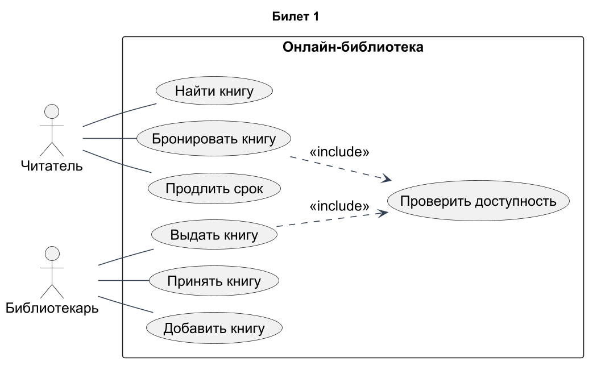
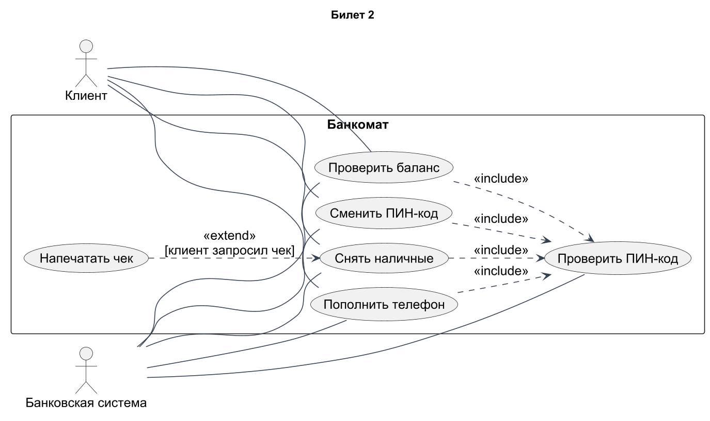
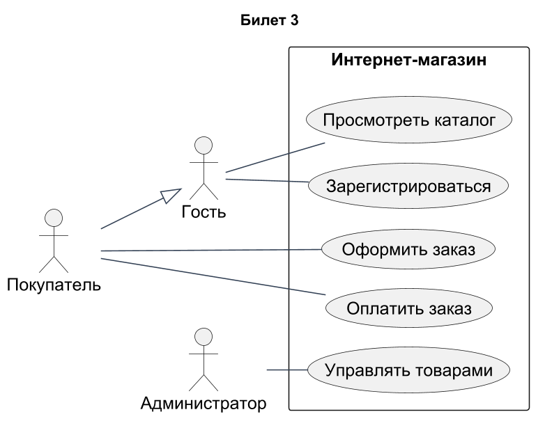
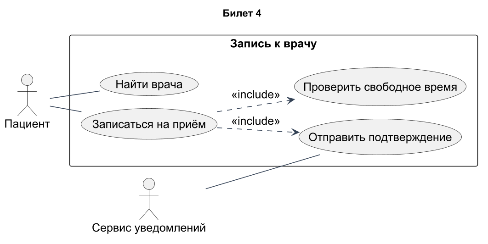

# Проектирование ПО · билеты 1–4

## Билет 1

### 1. Язык UML: история создания, назначение и области применения. Версии UML, роль консорциума OMG.

UML (Unified Modeling Language) — язык визуального моделирования структуры и поведения систем. Он вырос из объединения методов Гради Буча, Джеймса Рамбо и Ивара Якобсона в 1990-х годах; OMG принял UML 1.1 в 1997 году. В ветке UML 2.x расширены средства взаимодействий и архитектурного описания. UML применяют при анализе требований, проектировании, документировании и обсуждении решений; он не задаёт обязательный процесс разработки. OMG поддерживает спецификацию и её согласованность. В этих билетах используется нотация UML 2.x; нормативная основа — [UML 2.5.1](https://www.omg.org/spec/UML/2.5.1/).

### 2. Понятие зрелости процессов создания ПО. Признаки зрелой и незрелой организации.

Зрелость процессов — степень, в которой разработка определена, воспроизводима, контролируется и улучшается. В незрелой организации сроки и качество зависят от отдельных героев, требования меняются без учёта последствий, а проблемы решаются аврально. В зрелой организации есть согласованные роли, управление требованиями и изменениями, оценки, контроль качества, метрики и обучение на опыте. Зрелость не равна количеству документов: процессы должны реально применяться и помогать результату. Например, изменение требования сопровождают оценкой влияния, решением ответственного и обновлением тестов.

### Практическое задание

Онлайн-библиотека. Актёры: читатель, библиотекарь. Читатель ищет, бронирует книгу и продлевает срок. Библиотекарь выдаёт и принимает книги, добавляет новые. Показать границу системы и хотя бы одно отношение include.

### Решение

Выбрана диаграмма вариантов использования. Читатель выполняет поиск, бронирование и продление, библиотекарь — выдачу, возврат и добавление книг. Все функции находятся внутри границы «Онлайн-библиотека», актёры — снаружи. «Бронировать книгу» и «Выдать книгу» включают проверку доступности: стрелки include направлены к общей обязательной функции. Под доступностью для брони понимается возможность поставить бронь по правилам библиотеки, а не обязательно наличие экземпляра на полке.

[Исходник диаграммы](схемы/01.puml)

---

## Билет 2

### 1. Строительные блоки UML: сущности, отношения и диаграммы. Классификация диаграмм UML 2.x.

Строительные блоки UML — сущности, отношения и диаграммы. Сущности обозначают элементы модели: классы, интерфейсы, компоненты, действия, состояния; отношения связывают их ассоциацией, зависимостью, обобщением и реализацией. В UML 2.x выделяют 7 структурных диаграмм: классов, объектов, пакетов, компонентов, композитной структуры, развёртывания и профилей. Поведенческие: вариантов использования, деятельности, состояний и 4 диаграммы взаимодействия — последовательности, коммуникации, обзора взаимодействия, временная. Итого 14 видов. Диаграмма является представлением части модели, поэтому разные диаграммы должны согласовываться.

### 2. Модель оценки зрелости CMM: история создания, назначение и структура модели.

CMM (Capability Maturity Model) создана SEI при Carnegie Mellon для оценки и улучшения процессов разработки ПО; SW-CMM 1.1 опубликована в 1993 году. Модель описывает последовательное развитие организационных процессов через пять уровней зрелости. Уровни, кроме начального, содержат ключевые области процессов (KPA), цели и практики. Оценка ищет подтверждение устойчивого выполнения процессов, а не только наличие регламентов. CMM помогает определить слабые стороны и порядок улучшений; она не гарантирует безошибочность каждого продукта. [Источник SEI](https://www.sei.cmu.edu/library/capability-maturity-model-for-software-version-11/).

### Практическое задание

Банкомат. Актёры: клиент, банковская система. Варианты: снять наличные, проверить баланс, пополнить телефон, сменить ПИН-код. Все операции включают «Проверить ПИН-код» (include). «Напечатать чек» расширяет снятие наличных (extend).

### Решение

На диаграмме четыре основные операции клиента включают «Проверить ПИН-код». По условию проверка моделируется частью каждой операции, хотя в реальном банкомате возможна общая аутентифицированная сессия. Банковская система участвует в проверке и проведении операций. «Напечатать чек» расширяет снятие наличных только при запросе клиента; стрелка extend идёт от печати к снятию. Предусловия снятия — доступная карта и сеанс, успешный результат — выданные деньги и отражённая банковская операция.

[Исходник диаграммы](схемы/02.puml)

---

## Билет 3

### 1. Механизмы расширения UML: стереотипы, помеченные значения, ограничения. Понятие профиля UML.

Стереотип расширяет смысл элемента UML для предметной области, например «entity» у класса или «service» у компонента. Его свойства задают дополнительные значения, например version=2; исторически их называют помеченными значениями. Ограничение выражает обязательное условие, например {сумма >= 0}, на естественном языке или OCL. Профиль объединяет стереотипы, свойства и ограничения для согласованного применения в определённой области. Профиль уточняет UML, но не должен произвольно нарушать базовую семантику. Например, профиль корпоративных сервисов задаёт владельца и уровень критичности компонентов.

### 2. Уровни зрелости модели CMM: характеристика каждого уровня и ключевые области процессов.

В SW-CMM пять уровней: **1 Initial** — процесс непредсказуем, успех зависит от людей; **2 Repeatable** — повторяемое управление проектами; **3 Defined** — общие организационные процессы; **4 Managed** — количественное управление; **5 Optimizing** — непрерывное улучшение. На уровне 2 ключевы управление требованиями, планирование и контроль проекта, субподряд, обеспечение качества и конфигурации. На уровне 3 — организационный процесс, обучение, интегрированное управление, инженерия продукта, координация и экспертные проверки. На уровне 4 — количественное управление процессом и качеством; на уровне 5 — предотвращение дефектов и управление изменениями технологий и процессов. Это названия SW-CMM, их не следует смешивать с названиями CMMI. [Описание уровней SEI](https://insights.sei.cmu.edu/documents/1111/1994_005_001_435267.pdf).

### Практическое задание

Интернет-магазин. Актёры: гость, покупатель, администратор. Гость просматривает каталог и регистрируется. Покупатель оформляет и оплачивает заказ. Администратор управляет товарами. Показать обобщение актёров: покупатель наследует возможности гостя.

### Решение

Покупатель специализирует Гостя: пустой треугольник обобщения направлен к Гостю. Поэтому Покупатель наследует показанные связи Гостя и дополнительно оформляет и оплачивает заказы. Администратор управляет товарами. Регистрация оставлена у Гостя согласно условию; для уже зарегистрированного покупателя повторная регистрация обычно не является доступной целью и ограничивается предусловием «учётная запись ещё не создана». Каталог, оформление, оплата и администрирование находятся внутри границы магазина.

[Исходник диаграммы](схемы/03.puml)

---

## Билет 4

### 1. Общие механизмы UML: спецификации, дополнения (примечания), разделение на классы и экземпляры, интерфейсы и реализации.

Спецификация задаёт точную семантику элемента, а его рисунок на диаграмме показывает лишь выбранные свойства. Дополнения к обозначению — видимость, кратности, ограничения и другие уточнения; примечание изображается прямоугольником с загнутым углом и связывается с поясняемым элементом. Класс описывает множество однотипных объектов, экземпляр — конкретный объект с текущими значениями. Интерфейс определяет доступный контракт, реализация — способ его выполнения. Например, интерфейс Платёж задаёт оплатить(), а класс БанковскийПлатёж реализует операцию через API банка.

### 2. Порядок оценки зрелости организации. Переход от CMM к CMMI: ступенчатое и непрерывное представления.

Оценку зрелости проводят по области применения модели: выбирают подразделения и проекты, собирают документы, интервью и свидетельства практического выполнения, сопоставляют их с целями процессов и фиксируют пробелы. Затем утверждают план улучшений, ответственных и критерии проверки. CMMI объединила несколько моделей улучшения процессов. В классической CMMI 1.x ступенчатое представление задаёт общий уровень зрелости организации, непрерывное — профиль способностей отдельных областей процессов. Это разные способы планировать улучшение: готовая последовательность либо выбор приоритетных областей. При ответе важно назвать версию: терминология новых редакций CMMI может отличаться.

### Практическое задание

Запись к врачу. Построить диаграмму и письменно описать основной и один альтернативный сценарий варианта «Записаться на приём».

### Решение

**Предусловия:** пациент идентифицирован, расписание врача загружено. **Триггер:** пациент выбирает запись к врачу.

**Основной сценарий:** 1) пациент выбирает врача и дату; 2) система показывает свободные интервалы; 3) пациент выбирает время и подтверждает данные; 4) система повторно проверяет и атомарно резервирует интервал; 5) создаёт запись; 6) передаёт подтверждение в сервис уведомлений и показывает номер записи. **Постусловие:** создана одна запись, интервал занят этим пациентом.

**Альтернативный сценарий:** на шаге 4 время уже занял другой пациент. Система не создаёт запись, сообщает о конфликте и показывает актуальные интервалы; пациент возвращается к шагу 3 либо завершает операцию. Повторный запрос не должен создавать дубликат. На диаграмме проверка времени и отправка подтверждения выделены как include.

[Исходник диаграммы](схемы/04.puml)
