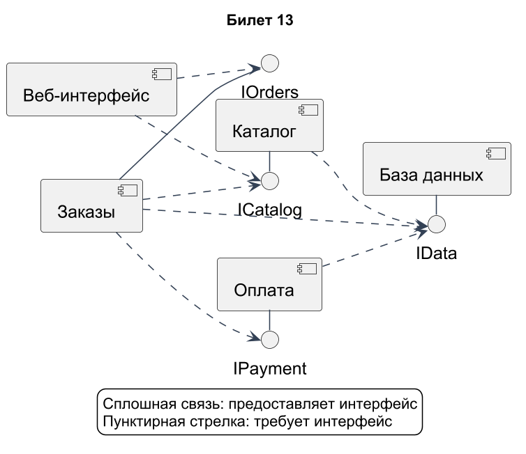
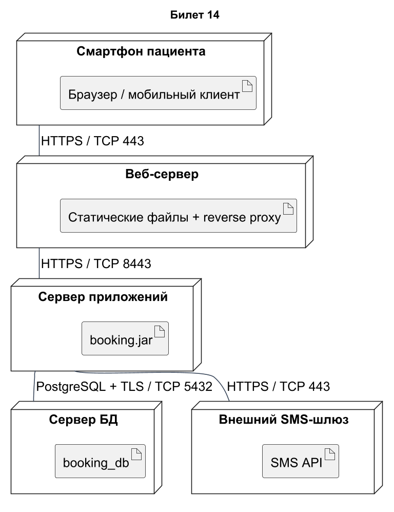
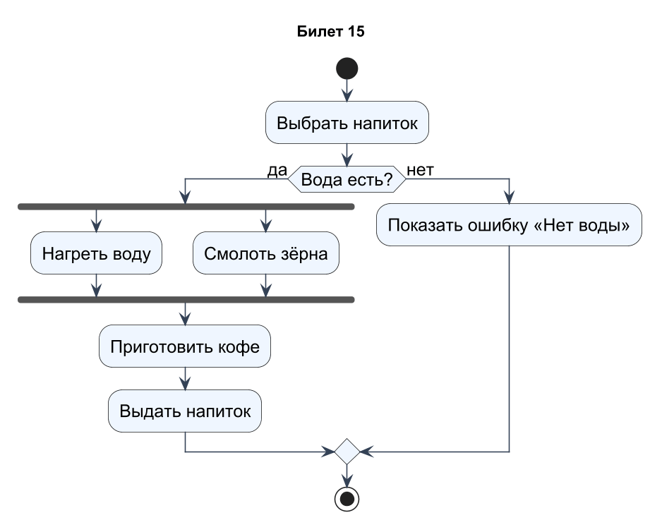
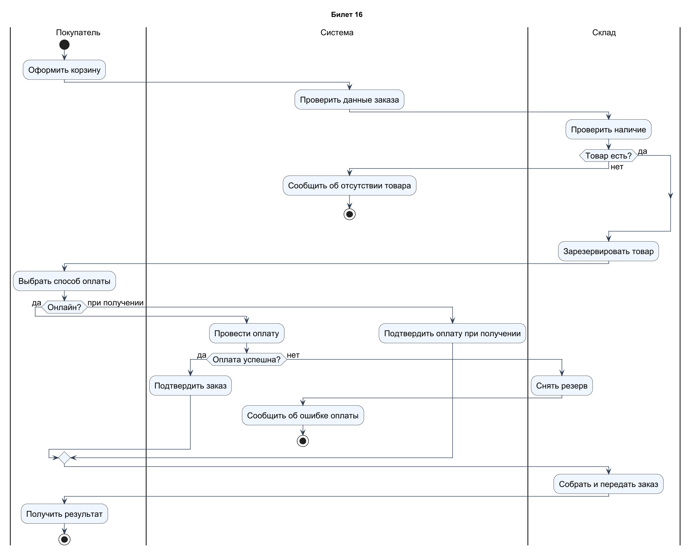

# Проектирование ПО · билеты 13–16

## Билет 13

### 1. Диаграмма компонентов: назначение, компоненты, интерфейсы (предоставляемые и требуемые), порты и соединители.

Компонент — модульная заменяемая часть системы, скрывающая реализацию за интерфейсами. Обозначается прямоугольником со значком компонента или «component». Предоставляемый интерфейс показывает услуги компонента и часто обозначается кружком; требуемый — зависимость от чужого контракта и изображается полукругом. Порт — точка взаимодействия на границе компонента. Соединители связывают совместимые требуемые и предоставляемые интерфейсы или делегируют обращение внутренней части. Диаграмма компонентов описывает логическую архитектуру, а не обязательно физические серверы.

### 2. Функциональная декомпозиция. Функциональная, информационная и поведенческая модели структурного анализа.

Функциональная декомпозиция разбивает крупную функцию на подфункции с понятными входами, выходами и ответственностью. Функциональная модель показывает, что система делает и как преобразует данные; информационная — какие данные и связи существуют; поведенческая — как система реагирует на события и меняет состояние. Например, DFD описывает обработку заявки, ER-модель — Заявку и Клиента, автомат — состояния заявки. Модели взаимно дополняют друг друга: все используемые данные должны быть определены, а переходы — поддерживаться функциями. Декомпозицию останавливают на уровне, достаточном для реализации или анализа.

### Практическое задание

Диаграмма компонентов интернет-магазина: Веб-интерфейс, Каталог, Заказы, Оплата, База данных, с предоставляемыми и требуемыми интерфейсами.

### Решение

Каталог предоставляет ICatalog, Заказы — IOrders, Оплата — IPayment, База данных — IData. Сплошная связь с кружком обозначает предоставление интерфейса, пунктирная зависимость «требует» — использование предоставленного контракта. Веб-интерфейс использует каталог и заказы; Заказы обращается к каталогу и оплате. Серверные компоненты работают с данными через IData, веб-клиент напрямую к БД не подключается. Для учебной модели IData обобщён; в реализации его можно разделить по ответственности. Это допустимая явная запись требуемых интерфейсов через зависимости usage, а не изображение физических сетевых соединений.

[Исходник диаграммы](схемы/13.puml)

---

## Билет 14

### 1. Диаграмма развёртывания: назначение, узлы, артефакты, каналы связи. Пример физической архитектуры системы.

Диаграмма развёртывания описывает размещение программных артефактов на узлах выполнения. Узел — устройство или среда выполнения, артефакт — файл, пакет, образ или иной физический результат разработки. Между узлами показывают каналы связи с протоколами, например HTTPS или PostgreSQL/TLS. Внутри сервера приложений можно разместить booking.jar, внутри сервера БД — схему booking_db. Компонент отвечает на вопрос «какая часть системы?», артефакт — «что развёртывается?», узел — «где?». Такая модель помогает оценить доступность, безопасность и нагрузку.

### 2. Структурное проектирование: модуль и его свойства, структурные карты, связность и сцепление модулей.

Модуль — относительно самостоятельная часть программы с определённой ответственностью и интерфейсом. Желательна высокая связность внутри модуля: его элементы решают одну задачу, и низкое сцепление между модулями: зависимостей мало и они явные. Структурная карта показывает иерархию вызовов и передаваемые данные/управление. Например, модуль расчёта стоимости не должен напрямую изменять внутренние таблицы модуля доставки. Разделение интерфейса и реализации, отсутствие глобального изменяемого состояния и простые контракты облегчают тестирование и сопровождение.

### Практическое задание

Диаграмма развёртывания онлайн-записи к врачу: смартфон пациента, веб-сервер, сервер приложений, сервер БД, SMS-шлюз, с артефактами и протоколами.

### Решение

Смартфон обращается к веб-серверу по HTTPS/443. Веб-сервер публикует статические файлы и передаёт API-запросы приложению по защищённому внутреннему каналу 8443. Приложение booking.jar использует PostgreSQL/TLS на 5432 и внешний SMS API по HTTPS/443. Артефакты размещены внутри узлов. Прямой доступ смартфона к БД отсутствует; firewall разрешает БД только соединения приложения. Порты внутреннего приложения выбраны как проектное допущение и должны совпадать с конфигурацией развёртывания.

[Исходник диаграммы](схемы/14.puml)

---

## Билет 15

### 1. Диаграмма композитной структуры: назначение, части, порты, соединители, кооперации.

Диаграмма композитной структуры показывает внутреннее устройство классификатора: части с ролями, порты и соединители между ними. Часть — используемый внутри экземпляр роли, например двигатель:Двигатель в Автомобиле. Порт на границе задаёт точку внешнего взаимодействия, соединитель показывает взаимодействие частей или делегирование. Кооперация описывает совместную работу ролей для выполнения определённого поведения. В отличие от обычной диаграммы классов здесь важна структура участников внутри конкретного контекста. Один класс может выполнять разные роли в разных кооперациях.

### 2. Методология SADT и стандарт IDEF0: история, назначение, основные понятия модели (цель, точка зрения, границы).

SADT (Structured Analysis and Design Technique), связанная с работами Дугласа Росса, предназначена для структурированного описания систем через функции и их взаимосвязи. IDEF0 развивает функциональную нотацию в рамках семейства IDEF и известен по FIPS PUB 183. Перед моделированием задают цель, точку зрения и границы: что исследуется, чьи вопросы решаются и что остаётся внешним. Модель состоит из функциональных блоков, стрелок ICOM и уровней декомпозиции. IDEF0 показывает функции и ограничения их выполнения, но не является точной временной блок-схемой алгоритма.

### Практическое задание

Приготовление кофе в кофемашине. Выбор напитка. Если воды нет – ошибка. Нагрев воды и помол зёрен выполняются параллельно.

### Решение

После выбора напитка проверяется наличие воды. Если воды нет, система показывает ошибку и завершает процесс. При наличии воды fork запускает нагрев и помол параллельно; join ожидает завершения обеих ветвей. Только после синхронизации начинается приготовление и выдача кофе. Допущение: зёрна, стакан и остальные ресурсы доступны; их проверки можно добавить отдельными условиями. Ромб отвечает за альтернативу, полосы fork/join — за параллельность.

[Исходник диаграммы](схемы/15.puml)

---

## Билет 16

### 1. Диаграмма деятельности: назначение, действия, узлы управления (начальный, конечный, решение, слияние).

Диаграмма деятельности моделирует поток действий и передачу управления/объектов. Начальный узел — заполненный круг; action — прямоугольник с округлениями; activity final — круг с внешним ободком. Ромб решения разделяет поток по сторожевым условиям, ромб слияния соединяет альтернативы без синхронизации. Условия на исходящих рёбрах должны быть понятными и не приводить к неоднозначности, например [оплачено] и [иначе]. Диаграмма описывает алгоритм или бизнес-процесс; для параллельности используют fork/join, а не обычное ветвление.

### 2. Функциональный блок и виды стрелок IDEF0. Отличие входа от управления. Контекстная диаграмма.

Блок IDEF0 обозначает функцию и обычно называется глагольной фразой. ICOM-стрелки входят: слева Input — преобразуемые входы, сверху Control — правила и ограничения, снизу Mechanism — исполнители и средства; справа выходят Output — результаты. Например, для «Проверить заявление» вход — заявление, управление — правила приёма, механизм — сотрудник, выход — решение. Вход преобразуется функцией, управление определяет способ выполнения и не обязано преобразовываться. Контекстная диаграмма A-0 содержит один блок A0 и его внешние интерфейсы.

### Практическое задание

Оформление заказа. Дорожки: Покупатель, Система, Склад. Проверка наличия товара, ветвление по способу оплаты.

### Решение

Дорожки разделяют ответственность: Покупатель оформляет и выбирает оплату, Система проверяет данные и проводит платёж, Склад проверяет наличие и резервирует товар. При отсутствии товара заказ не подтверждается. Для онлайн-оплаты успех ведёт к подтверждению, ошибка — к снятию резерва и сообщению покупателю. При оплате при получении заказ подтверждается без предварительного списания. После успешной ветви склад собирает и передаёт заказ; финансовый расчёт при вручении находится за границей показанного процесса.

[Исходник диаграммы](схемы/16.puml)
