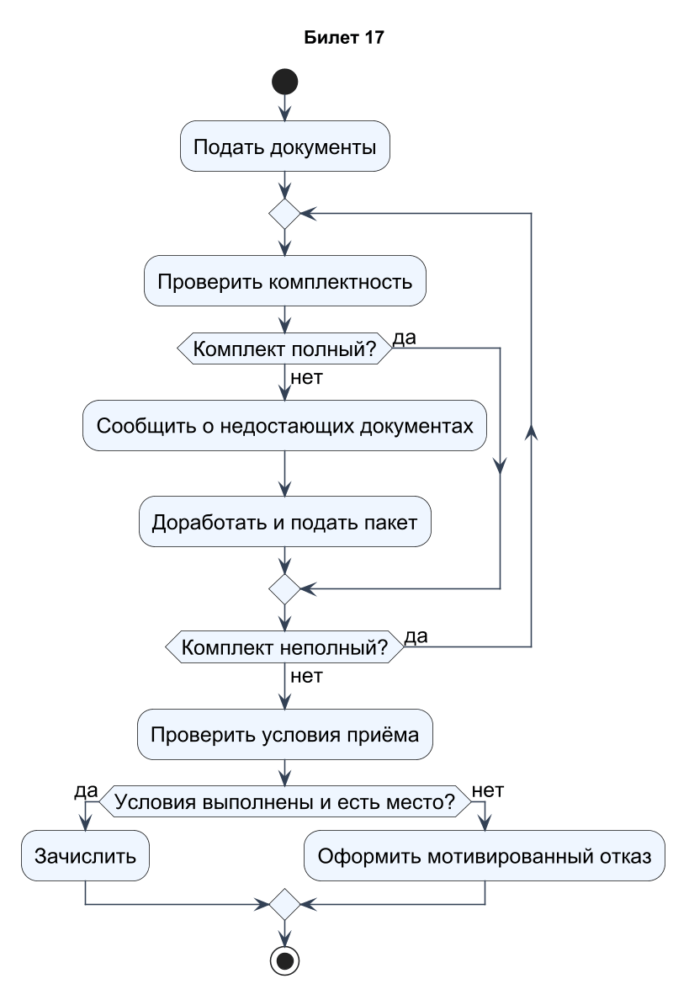
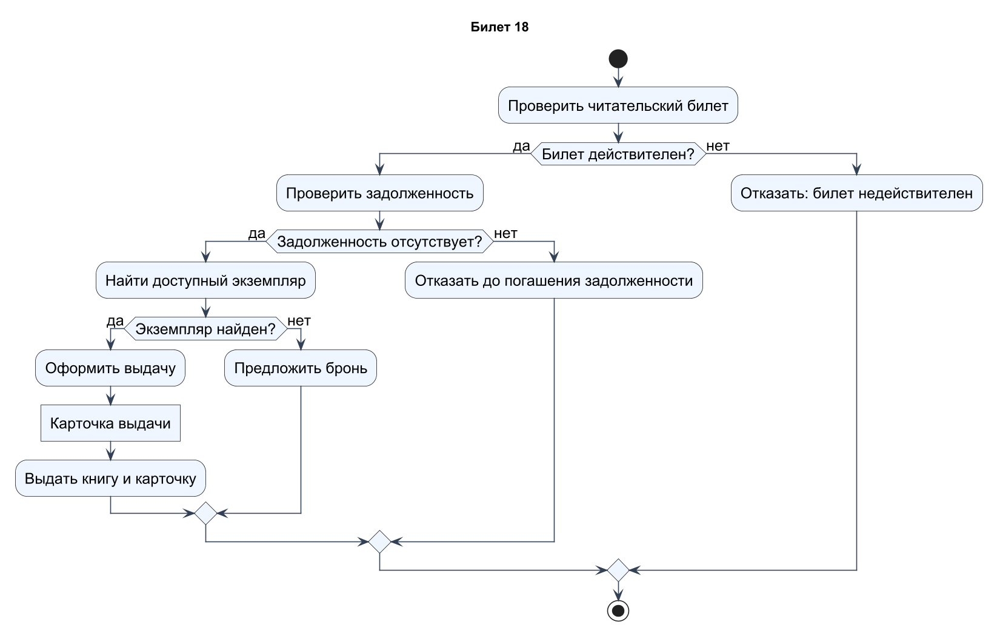
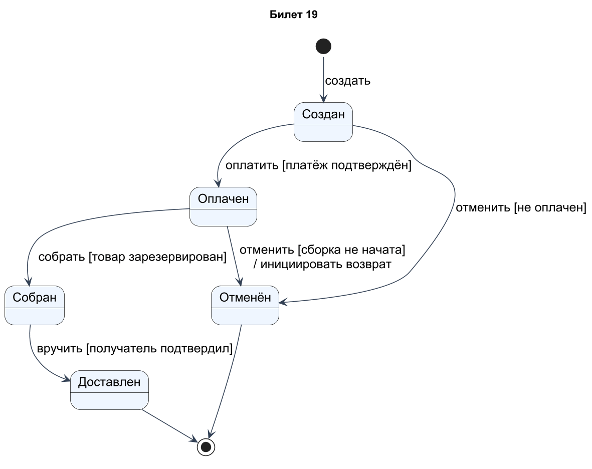
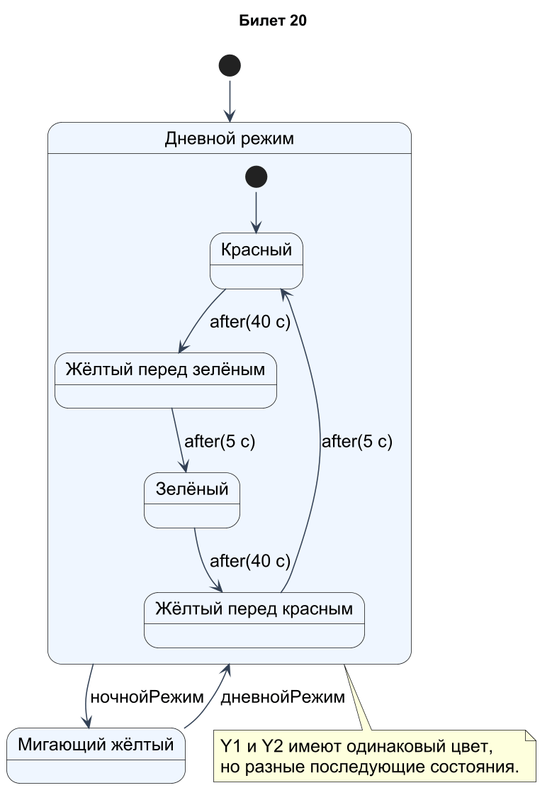

# Проектирование ПО · билеты 17–20

## Билет 17

### 1. Параллельные потоки на диаграмме деятельности: разделение и соединение, разделы (дорожки), объектные потоки.

Fork — толстая полоса с одним входом и несколькими выходами, запускающая параллельные потоки. Join синхронизирует их: дальнейший шаг разрешён после поступления требуемых токенов, обычно со всех входов. Дорожки группируют действия по ответственным ролям или подразделениям и сами не меняют порядок исполнения. Объектный поток переносит данные или объекты между действиями, например «Карточка выдачи» от оформления к печати. Нельзя заменять join ромбом слияния: merge не ждёт завершения всех параллельных ветвей.

### 2. Декомпозиция в IDEF0: правила построения диаграмм, нумерация, согласованность диаграмм и ICOM-коды.

В IDEF0 родительскую функцию раскрывают дочерней диаграммой, обычно из 3–6 блоков. A-0 — контекст, A0 — декомпозиция верхней функции, A1 — раскрытие блока 1 на A0, далее A11 и т.д. Внешние стрелки дочерней диаграммы согласуют с интерфейсами родительского блока; ICOM-коды I1, C1, O1, M1 связывают соответствующие граничные стрелки. Нужно сохранять смысл, имена и направление потоков, а не копировать расположение. Детализацию выбирают по цели модели, поддерживая словарь терминов и пояснения к блокам.

### Практическое задание

Поступление в колледж. Подача и проверка документов, цикл доработки при неполном пакете, зачисление или отказ.

### Решение

Документы проверяются в цикле. Неполный пакет возвращается на доработку, после повторной подачи проверка выполняется снова. Когда комплект полон, комиссия оценивает условия приёма и наличие места: результат — зачисление либо мотивированный отказ. Проверка комплектности не равна положительному решению о приёме. Предполагается, что абитуриент продолжает доработку в допустимый срок; отдельную ветвь отказа от подачи можно добавить при уточнении требований.

[Исходник диаграммы](схемы/17.puml)

---

## Билет 18

### 1. Диаграмма состояний (конечный автомат): назначение, состояния, переходы, события, сторожевые условия, действия.

Диаграмма состояний показывает жизненный цикл объекта как состояния и переходы при событиях. Состояние — устойчивая ситуация или режим, а не просто очередная команда. Подпись перехода: событие [условие] / действие; условие проверяется при событии, действие выполняется при переходе. Внутри состояния могут быть entry, do и exit. Например, оплатить [сумма достаточна] / зафиксироватьПлатёж переводит заказ из «Создан» в «Оплачен». Начальный псевдоузел задаёт вход, конечный — завершение жизненного цикла в модели.

### 2. Виды связей между блоками IDEF0. Разветвление, слияние и туннелирование стрелок.

Выход одного блока IDEF0 может стать входом другого, его управляющей информацией или механизмом. Обратная связь возвращает результат к более ранней функции для корректировки, но положение блоков не задаёт жёсткое время исполнения. Разветвление означает передачу всего потока или его именованных частей нескольким получателям; слияние объединяет потоки с понятным составом. Туннелирование позволяет не показывать стрелку на соседнем уровне и отмечается специальными скобками; его нужно объяснять, чтобы не потерять интерфейс. Необъяснённое исчезновение входа при декомпозиции является ошибкой.

### Практическое задание

Выдача книги. Проверка билета, проверка задолженности, поиск экземпляра, выдача. Объектный поток «Карточка выдачи».

### Решение

Выдача разрешена только при действительном билете, отсутствии задолженности и наличии экземпляра. При нарушении условий показаны отказ либо предложение бронирования. Действие «Оформить выдачу» создаёт объект «Карточка выдачи», передаваемый следующему действию; прямоугольный объектный узел отличает этот поток от чистого управления. Карточка должна содержать читателя, инвентарный номер, дату выдачи и срок возврата. После выдачи экземпляр становится недоступным для другой активной выдачи.

[Исходник диаграммы](схемы/18.puml)

---

## Билет 19

### 1. Составные состояния, подсостояния, параллельные области и исторические состояния на диаграмме состояний.

Составное состояние содержит вложенные состояния; вход обычно идёт в его начальное подсостояние. Взаимоисключающие подсостояния описывают альтернативные режимы, ортогональные области — одновременно активные части поведения. Исторический псевдоузел H возвращает к последнему активному непосредственному подсостоянию, H* — восстанавливает глубокую вложенную конфигурацию. Например, после временной блокировки устройство может вернуться к прежнему рабочему режиму. Переход, выходящий из составного состояния, применим к его активной вложенной конфигурации согласно семантике автомата.

### 2. Назначение метода IDEF3 и его отличие от IDEF0. Виды диаграмм IDEF3.

IDEF3 предназначен для фиксации сценариев протекания процессов: какие работы происходят, в каком порядке и при каких условиях. В отличие от функционального IDEF0, он подчёркивает последовательность и причинно-временные связи. Два представления: Process Flow Description (PFD), описывающее единицы работ и связи, и Object State Transition Network (OSTN), показывающее изменения состояния объектов. Например, PFD описывает «принять — проверить — согласовать заявку», OSTN — переходы заявки между статусами. Сценарий фиксируется с определённой точки зрения и не обязан перечислять все возможные процессы организации.

### Практическое задание

«Заказ»: создан → оплачен → собран → доставлен. Отмена возможна из «создан» и «оплачен». Указать события и сторожевые условия.

### Решение

Основная цепочка: Создан → Оплачен → Собран → Доставлен. Переходы имеют события и условия: подтверждение платежа, наличие резерва, подтверждение вручения. Отмена разрешена из Создан и Оплачен, но не из Собран. При отмене оплаченного заказа инициируется возврат; факт завершения возврата в этой упрощённой модели отдельно не рассматривается. Доставлен и Отменён завершают показанный жизненный цикл. Условие «сборка не начата» фиксирует границу допустимой отмены.

[Исходник диаграммы](схемы/19.puml)

---

## Билет 20

### 1. Диаграмма последовательности: назначение, линии жизни, сообщения, фокус управления (активации).

Диаграмма последовательности показывает обмен сообщениями между участниками во времени, обычно сверху вниз. Участник имеет заголовок и вертикальную линию жизни; прямоугольник активации отмечает период выполнения поведения. Стрелки обозначают вызовы и ответы, а горизонтальное расположение участников помогает читать взаимодействие. Например, Форма → Сервер: войти(), Сервер → БД: найтиПользователя(), затем ответ форме. Она показывает конкретный сценарий или набор альтернатив, а не полную структуру классов. Порядок по вертикали важен, но геометрическое расстояние обычно не равно реальной длительности.

### 2. Элементы диаграмм IDEF3: единицы работы, виды связей, перекрёстки и правила их использования.

Основной элемент IDEF3 — UOB (Unit of Behavior), единица поведения/работы с номером и названием. Связи отражают предшествование, передачу объектов или дополнительные отношения, поясняемые моделью. Перекрёстки AND, OR и XOR разделяют и объединяют ветви: все, одна или несколько, ровно одна соответственно. Синхронность уточняет требования к совместному началу или завершению. Ветвление и слияние нужно согласовывать по смыслу; нельзя без объяснения объединять XOR-альтернативы узлом, ожидающим все ветви. Условия и сценарии уточняют в сопроводительном описании.

### Практическое задание

«Светофор»: красный, жёлтый, зелёный, мигающий жёлтый (ночной режим). Переходы по таймеру и по команде «ночной режим».

### Решение

Дневной цикл состоит из красного, жёлтого перед зелёным, зелёного и жёлтого перед красным. Два жёлтых состояния имеют одинаковый внешний цвет, но разные дальнейшие переходы, поэтому различены логически. Таймеры 40/5/40/5 секунд выбраны для примера, так как в условии длительности не заданы. Команда ночнойРежим переводит всё составное дневное состояние в Мигающий жёлтый; дневнойРежим возвращает к красному. Это учебный автомат, без детального алгоритма безопасного переключения реального перекрёстка.

[Исходник диаграммы](схемы/20.puml)
