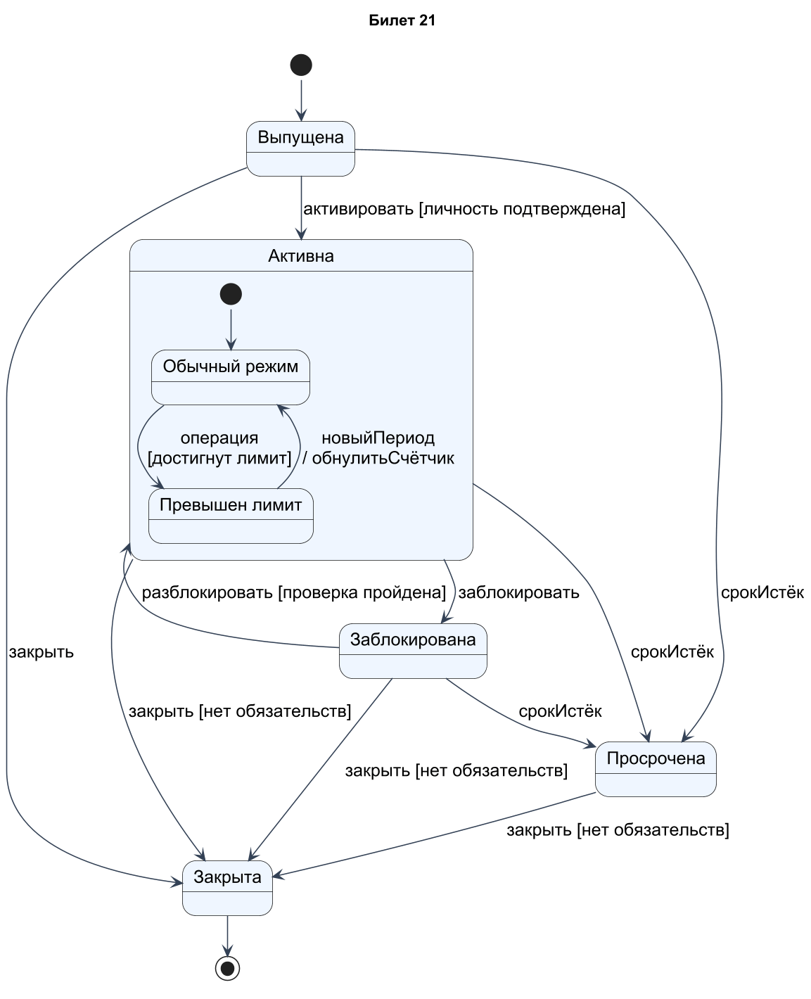
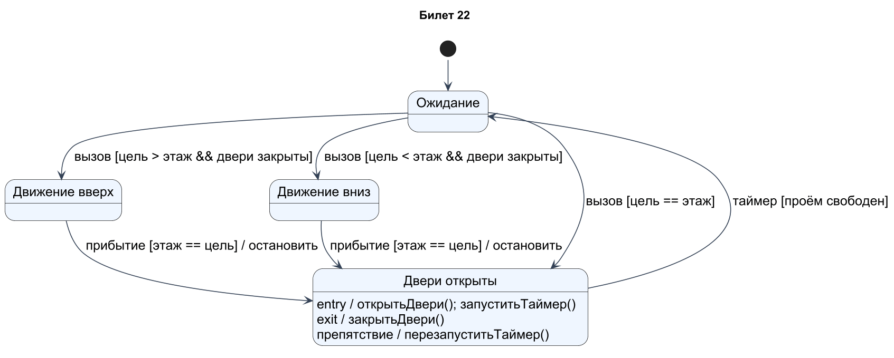
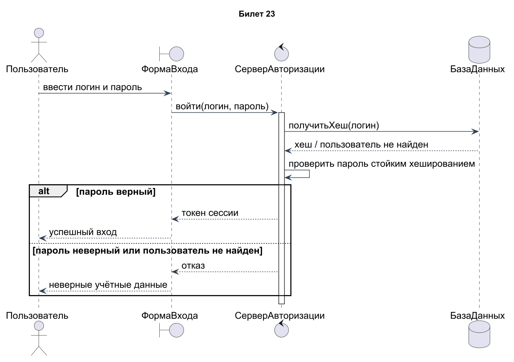
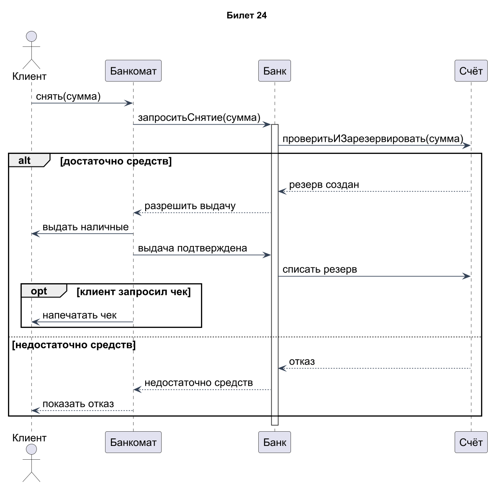

# Проектирование ПО · билеты 21–24

## Билет 21

### 1. Виды сообщений на диаграмме последовательности: синхронные, асинхронные, ответные, создание и уничтожение объектов.

Синхронное сообщение вызывает операцию и обычно предполагает ожидание результата; обозначается сплошной линией с заполненным наконечником. Асинхронное отправляется без ожидания завершения и имеет открытый наконечник. Ответное сообщение обычно пунктирное и возвращает результат. Сообщение создания приходит к началу линии жизни нового объекта, уничтожение заканчивается крестом X. Например, сервис отправляет уведомление асинхронно, но синхронно запрашивает баланс. Вид стрелки выражает семантику взаимодействия, а не сетевой протокол сам по себе.

### 2. Декомпозиция в IDEF3, объекты-ссылки и диаграммы переходов состояний объектов (OSTN).

IDEF3 допускает раскрытие единицы работы более подробным сценарием с сохранением связи с родительским описанием. Для одного UOB возможны альтернативные декомпозиции с явным указанием контекста. Объекты-ссылки (referents) отсылают к другой работе, сценарию или объекту и позволяют избежать дублирования. OSTN описывает состояния объекта и допустимые переходы, связывая их с работами процесса. Например, «Документ: черновик → проверен → утверждён» связан с подготовкой, проверкой и согласованием. Нужно сохранять идентичность объекта между состояниями.

### Практическое задание

«Банковская карта»: выпущена, активна, заблокирована, просрочена, закрыта. «Активна» – составное состояние с подсостояниями «обычный режим» и «превышен лимит».

### Решение

Карта начинается в состоянии Выпущена и после подтверждения личности становится Активна. Внутри Активна показаны Обычный режим и Превышен лимит; в последнем новые расходные операции ограничиваются правилами продукта. Новый расчётный период возвращает обычный режим. Блокировка и истечение срока выводят карту из активного состояния; истечение срока возможно также для выпущенной и заблокированной карты. Закрытие разрешено при отсутствии обязательств. При разблокировке схема входит в обычный режим; если требуется сохранить лимит, его надо повторно вычислить или использовать историческое состояние.

[Исходник диаграммы](схемы/21.puml)

---

## Билет 22

### 1. Комбинированные фрагменты на диаграмме последовательности: alt, opt, loop, par, ref и другие.

Комбинированный фрагмент задаёт управляющую конструкцию взаимодействия. **alt** — выбор одной ветви по условию; **opt** — необязательный блок; **loop** — повторение с границами и условием; **par** — параллельные операнды. **break** прекращает оставшуюся часть взаимодействия при условии; **critical** выделяет неделимый участок; **assert/neg** задают допустимое/недопустимое поведение. **ref** обозначает ссылку на другое взаимодействие (interaction use). Например, alt [пароль верный]/[иначе] возвращает сессию либо ошибку. Условия должны быть определены в терминах модели.

### 2. Диаграммы потоков данных (DFD): назначение, элементы и нотации Гейна – Сарсона и Йордона – Де Марко.

DFD описывает движение и преобразование данных, а не последовательность команд. Четыре элемента: процесс, поток данных, хранилище и внешняя сущность. В нотации Йордона–Де Марко процесс часто изображают кругом, хранилище — параллельными линиями; у Гейна–Сарсона процесс имеет скруглённый прямоугольник, хранилище — открытый прямоугольник с идентификатором. Внешняя сущность — прямоугольник, поток — подписанная стрелка. Процессы называют глагольной фразой, данные — существительным. Например, «Проверить заказ» получает «Данные заказа» и выдаёт «Результат проверки».

### Практическое задание

«Лифт»: ожидание, движение вверх, движение вниз, двери открыты. Действия entry и exit для состояния «двери открыты».

### Решение

Из Ожидания лифт выбирает движение вверх или вниз по сравнению текущего и целевого этажей; если этаж совпадает, открывает двери. При прибытии движение останавливается, затем выполняется entry состояния «Двери открыты»: открыть двери и запустить таймер. На выходе выполняется exit: закрыть двери. Если проём занят, таймер перезапускается; выход возможен только при свободном проёме. Для движения дополнительно требуется закрытая дверь. Реальные аварийные блокировки и очередь вызовов находятся за границей этой четырёхсостоянийной учебной модели.

[Исходник диаграммы](схемы/22.puml)

---

## Билет 23

### 1. Диаграмма коммуникации: назначение, элементы, нумерация сообщений. Сравнение с диаграммой последовательности.

Диаграмма коммуникации показывает участников взаимодействия, их связи и сообщения, подписанные на этих связях. Порядок передаётся номерами: 1, 1.1, 1.2, 2; вложенность отражает вызовы внутри выполнения другого сообщения. Можно указывать условия и повторения. В диаграмме последовательности удобнее видеть порядок, ожидание и альтернативные фрагменты; в коммуникации — структуру связей между участниками. При согласованном описании обе показывают один сценарий с разных сторон. Без нумерации коммуникационная диаграмма теряет существенную информацию о порядке.

### 2. Правила построения DFD. Контекстная диаграмма и порядок её построения.

Контекстная DFD изображает систему одним процессом и показывает только внешние сущности и потоки между ними и системой. Сначала определяют границы, затем внешних поставщиков/получателей данных и именуют входы и выходы. Между внешней сущностью и хранилищем или между двумя хранилищами не проводят обмен в обход процесса. Каждый процесс должен иметь осмысленные входы и выходы. На контексте обычно не раскрывают внутренние хранилища. DFD не следует перегружать условиями «да/нет»: это не блок-схема управления.

### Практическое задание

Вход в систему. Участники: Пользователь, ФормаВхода, СерверАвторизации, БазаДанных. Фрагмент alt: пароль верный или неверный.

### Решение

Пользователь вводит учётные данные в форму, форма передаёт их серверу авторизации. Сервер получает из БД хеш и проверяет пароль; открытый пароль в БД не хранится. Фрагмент alt разделяет правильный и неправильный пароль: создаётся токен сессии либо возвращается общее сообщение об отказе. Одинаковое сообщение для неизвестного логина и неверного пароля не раскрывает наличие учётной записи. Предполагается защищённый TLS-канал и ограничения частоты попыток; они не меняют порядок основного взаимодействия.

[Исходник диаграммы](схемы/23.puml)

---

## Билет 24

### 1. Диаграмма обзора взаимодействия: назначение, элементы, связь с диаграммами деятельности и последовательности.

Диаграмма обзора взаимодействия объединяет управляющую структуру диаграммы деятельности и ссылки на отдельные взаимодействия. Узлами выступают interaction use с ref или встроенные фрагменты, а решения, fork/join и начало/конец задают общий поток. Например, «Авторизация» → «Выбор товара» → alt по оплате → «Подтверждение». Подробные сообщения остаются в диаграммах последовательности, поэтому обзор читается компактно. Она нужна, когда несколько взаимодействий образуют единый сценарий, но их полное объединение было бы громоздким.

### 2. Декомпозиция DFD и балансировка диаграмм. Словарь данных и мини-спецификации процессов.

При декомпозиции DFD процесс заменяют сетью дочерних процессов, потоков и хранилищ. Балансировка означает, что суммарные внешние входы и выходы дочерней диаграммы соответствуют родительскому процессу; составные потоки можно раскрывать при определённом словаре данных. Словарь фиксирует структуру, тип, смысл и ограничения каждого потока и хранилища. Мини-спецификация описывает логику элементарного процесса текстом, псевдокодом или таблицей решений. Например, «Данные заказа» раскладываются на реквизиты клиента и позиции, но не появляются из ничего.

### Практическое задание

Снятие наличных. Участники: Клиент, Банкомат, Банк, Счёт. Фрагменты alt (достаточно средств или нет) и opt (печать чека).

### Решение

Предусловие — клиент уже аутентифицирован, сумма допустима и банкомат исправен. Банк атомарно проверяет и резервирует сумму на счёте. В ветви alt «достаточно средств» банкомат выдаёт наличные, подтверждает выдачу банку, после чего резерв списывается; в ветви отказа деньги не выдаются. opt включает печать чека только по выбору клиента. Ошибка механизма выдачи требует снятия резерва/сверки и не показана в основном сценарии; нельзя считать простой экранный успех доказательством выдачи денег.

[Исходник диаграммы](схемы/24.puml)
