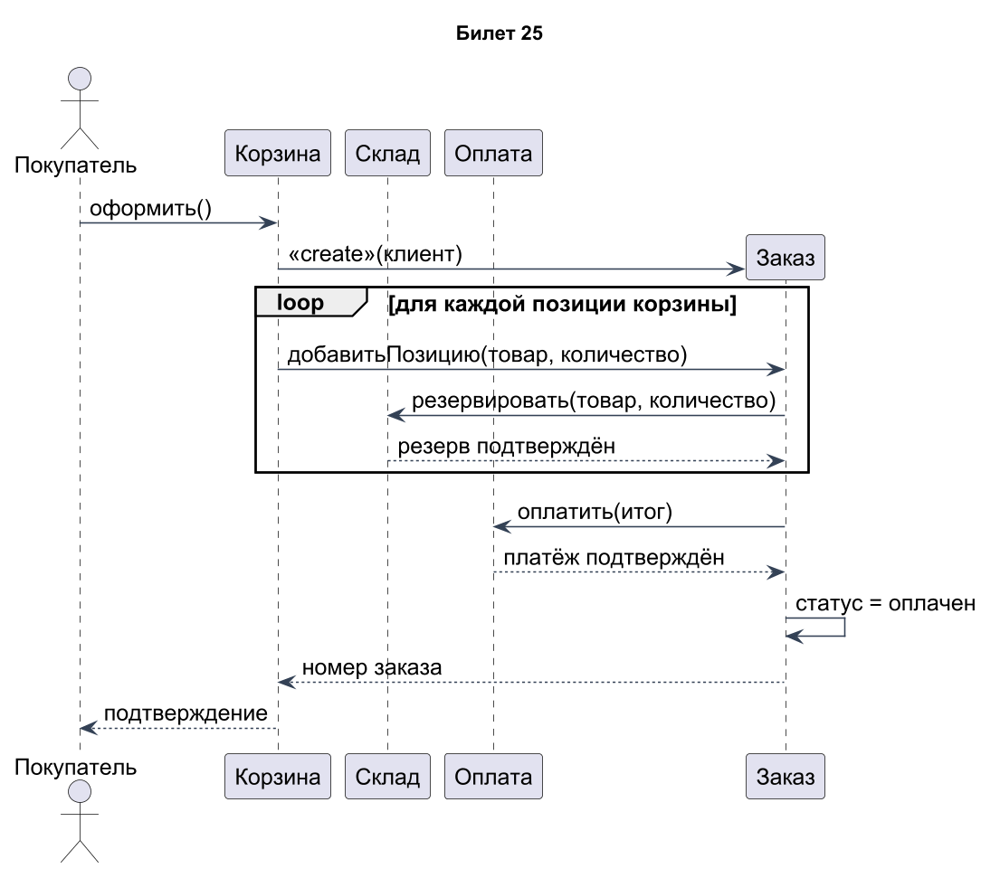
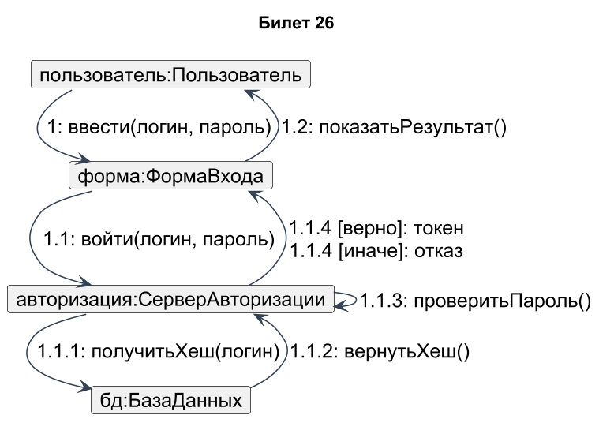
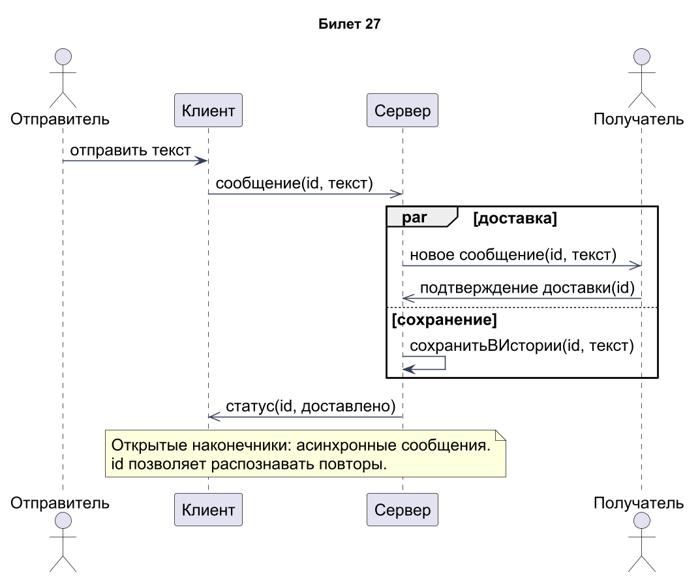
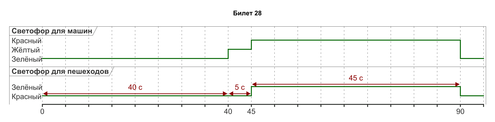

# Проектирование ПО · билеты 25–28

## Билет 25

### 1. Временная диаграмма (Timing Diagram) UML: назначение, область применения, место среди диаграмм взаимодействия.

Временная диаграмма UML показывает изменение состояния или значения участников относительно явной временной шкалы. Она относится к диаграммам взаимодействия вместе с последовательностью, коммуникацией и обзором взаимодействия. Используется в системах реального времени, протоколах, устройствах и сценариях с задержками. Например, важно показать, что магнетрон включён ровно 60 секунд, а дверь закрыта весь этот интервал. В отличие от обычной диаграммы последовательности, реальные моменты и длительности являются центральной частью модели.

### 2. Типичные ошибки DFD. Логические и физические диаграммы потоков данных. Использование DFD при проектировании.

Типичные ошибки DFD: процесс без входов («чудо»), без выходов («чёрная дыра»), выходы, необъяснимые входами («серая дыра»), неименованные потоки и обмен в обход процессов. Нарушением является и потеря внешнего потока при декомпозиции. Логическая DFD описывает бизнес-преобразования независимо от реализации; физическая уточняет программы, носители, роли и размещение. DFD помогает находить данные, обязанности процессов и границы интеграций. Её проверяют вместе со словарём данных и мини-спецификациями.

### Практическое задание

Оформление заказа. Участники: Покупатель, Корзина, Заказ, Склад, Оплата. Создание объекта Заказ, фрагмент loop по позициям.

### Решение

Объект Заказ создаётся во время сценария: его линия жизни начинается у сообщения <<create>>. Цикл loop добавляет каждую позицию и резервирует её на складе. Затем Заказ запрашивает оплату общей суммы, меняет статус и возвращает номер через Корзину покупателю. Показан успешный путь; при отказе резерва или оплаты необходимо отменить ранее созданные резервы и не присваивать статус «оплачен». Цена и количество должны фиксироваться в позиции, чтобы сумма соответствовала подтверждённому заказу.

[Исходник диаграммы](схемы/25.puml)

---

## Билет 26

### 1. Элементы временной диаграммы: линии жизни, временная шкала, состояния и условия, линия состояния, изменение состояния во времени.

Элементы временной диаграммы — участники/линии жизни, временная шкала, состояния или значения, точки изменений и сообщения. На линии состояния высота соответствует режиму, горизонтальный участок — времени пребывания, вертикальный переход — изменению. Указывают единицу времени, начало отсчёта и границы интересующих интервалов. Для нескольких участников используют общую шкалу, чтобы видеть одновременность. Например, на интервале [0;40) машины имеют зелёный, пешеходы — красный; в момент 45 с состояния согласованно меняются.

### 2. Объектно-ориентированный подход: причины появления, отличие от структурного подхода, преимущества.

Объектно-ориентированный подход возник как способ управлять сложностью, связывая данные с поведением и моделируя устойчивые понятия предметной области. В структурном подходе первично функциональное разбиение, в объектном — объекты и распределённые между ними обязанности. Инкапсуляция защищает инварианты, полиморфизм позволяет заменять реализации через общий контракт, композиция помогает собирать поведение. Преимущества — локализация изменений, повторное использование и удобство тестирования при качественном проектировании. Неудачная иерархия наследования способна усилить связанность, поэтому ООП не гарантирует качество автоматически.

### Практическое задание

Диаграмма коммуникации для сценария «Вход в систему» (Пользователь, ФормаВхода, СерверАвторизации, БазаДанных) с нумерацией сообщений. Сравнить её с диаграммой последовательности в 2–3 предложениях.

### Решение

Сообщение 1 передаёт ввод от пользователя к форме; 1.1 вызывает сервер; 1.1.1–1.1.3 получают хеш и проверяют пароль. Взаимоисключающие ответы 1.1.4 зависят от результата, сообщение 1.2 показывает его пользователю. Диаграмма коммуникации подчёркивает связи участников, а порядок задаёт нумерацией. В диаграмме последовательности тот же сценарий читается сверху вниз, и альтернативы удобнее показать рамкой alt. Состав участников и смысл сообщений должны совпадать в обоих представлениях.

[Исходник диаграммы](схемы/26.puml)

---

## Билет 27

### 1. Временные ограничения и ограничения продолжительности на временной диаграмме. Сообщения между линиями жизни.

Временное ограничение задаёт допустимый момент события относительно точки отсчёта, например t_open ≤ t_call+30 с. Ограничение продолжительности задаёт интервал между двумя событиями, например {5..10 с} или {60 с}. Сообщения связывают события разных линий жизни и позволяют показать задержку доставки либо реакции. Важно указать, какие именно события ограничиваются: команда открыть и фактическое открытие — разные вещи. Ограничение является требованием, а конкретный нарисованный момент — одним сценарием, удовлетворяющим ему.

### 2. Главные и дополнительные элементы объектной модели по Г. Бучу: абстрагирование, инкапсуляция, модульность, иерархия, типизация, параллелизм, сохраняемость.

По Г. Бучу основные элементы объектной модели: абстрагирование, инкапсуляция, модульность и иерархия. Абстрагирование выделяет существенные свойства; инкапсуляция скрывает реализацию; модульность разделяет систему на согласованные части; иерархия организует отношения уровней и типов. Дополнительные элементы — типизация, параллелизм и сохраняемость. Типизация ограничивает допустимые операции, параллелизм допускает независимое выполнение, сохраняемость продлевает жизнь объекта за пределы одного запуска. Например, Заказ скрывает изменение статуса и сохраняется в БД, а разные заказы обрабатываются параллельно.

### Практическое задание

Мессенджер. Участники: Отправитель, Клиент, Сервер, Получатель. Асинхронные сообщения. Фрагмент par: доставка получателю и сохранение в истории одновременно.

### Решение

Клиент передаёт сообщение серверу асинхронно, не блокируя интерфейс до окончания доставки. Фрагмент par содержит две параллельные ветви: доставку с подтверждением и запись сообщения в историю. После выполнения показанных ветвей сервер отправляет статус клиенту; открытые наконечники показывают асинхронные отправки. У сообщения есть id для защиты от дублирования при повторе. При требованиях гарантированной доставки сохранение обычно делают до отправки; здесь параллельность выбрана прямо по условию билета.

[Исходник диаграммы](схемы/27.puml)

---

## Билет 28

### 1. Формы представления временной диаграммы: линия состояния и линия общего значения. Сравнение временной диаграммы с диаграммами последовательности и состояний.

Линия состояния располагает возможные состояния на отдельных уровнях и показывает переходы между ними. Компактная линия общего значения (value lifeline) подписывает действующее значение внутри последовательных временных участков и экономит место. Временная диаграмма отвечает «когда и как долго», последовательности — «кто кому и в каком порядке», состояний — «какие переходы вообще допустимы». Один сценарий светофора можно показать во всех трёх видах. При выборе формы сохраняют однозначность моментов перехода и читаемость нескольких линий.

### 2. Построение объектной модели предметной области: выделение и отбор классов, распределение обязанностей, CRC-карты.

Объектную модель строят от сценариев и словаря предметной области: выделяют кандидатов в классы, удаляют дубли, несущественные детали и роли, не требующие отдельной сущности. Затем задают обязанности, свойства, идентичность и связи с кратностями. CRC-карта содержит Class, Responsibilities, Collaborators — класс, его обязанности и сотрудников. Например, Заказ отвечает за сумму и допустимые переходы статуса, сотрудничает с Позициями и Оплатой. Модель проверяют проигрыванием сценариев: все действия должны иметь исполнителя, а класс не должен концентрировать всю логику системы.

### Практическое задание

Светофор на перекрёстке. Две линии жизни, «Светофор для машин» и «Светофор для пешеходов», интервал 90 с. У машин зелёный 40 с, жёлтый 5 с, красный 45 с. Пешеходам зелёный горит, пока у машин красный.

### Решение

Используется общий интервал 0–90 с. Машины: [0;40) зелёный, [40;45) жёлтый, [45;90) красный. Пешеходы: [0;45) красный, [45;90) зелёный. В t=90 начинается следующий цикл. Длительности машин суммируются в 90 с, пешеходный зелёный точно совпадает с красным машин. Отдельные интервалы очистки перекрёстка в условии отсутствуют, поэтому здесь изображён заданный учебный цикл, а не нормативный проект реального светофорного объекта.

[Исходник диаграммы](схемы/28.puml)
