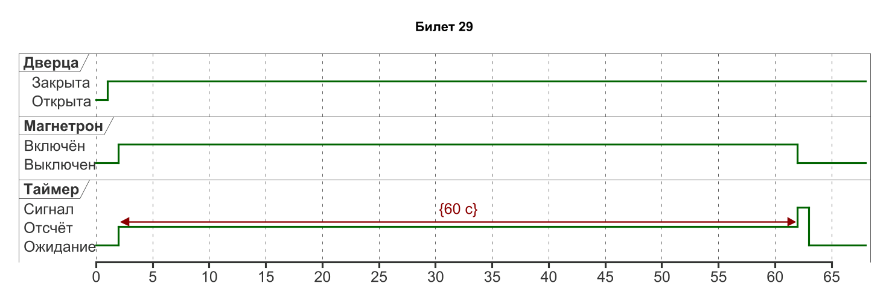
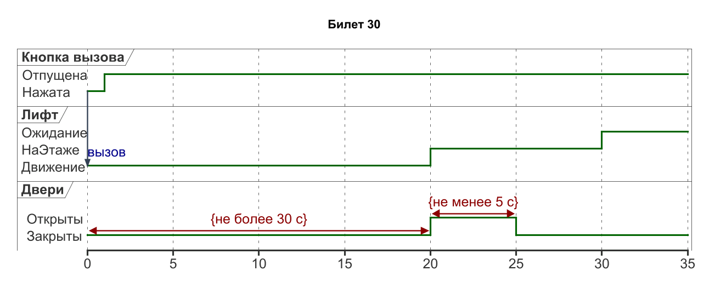

# Проектирование ПО · билеты 29–30

## Билет 29

### 1. Использование диаграмм UML на этапах жизненного цикла ПО: анализ требований, проектирование, реализация, развёртывание.

На анализе требований используют варианты использования, деятельность и концептуальные классы. При проектировании уточняют классы, интерфейсы, последовательности, состояния и компоненты. На реализации диаграммы помогают согласовывать контракты и проверять соответствие кода модели; при развёртывании показывают узлы, артефакты и протоколы. Набор диаграмм выбирают по рискам и задачам, а не из обязанности нарисовать все 14 видов. Изменённое требование должно отражаться в связанных сценариях, проектных решениях и тестах.

### 2. Объект и класс: состояние, поведение и идентичность объекта; виды операций; интерфейс и реализация класса.

Класс задаёт общие свойства и операции, объект — конкретный экземпляр. Состояние объекта определяется значениями атрибутов и связями, поведение — доступными действиями и реакциями, идентичность отличает объект от другого даже при одинаковых данных. Операции бывают создающими/уничтожающими, изменяющими состояние, запрашивающими и вспомогательными. Интерфейс класса задаёт доступный контракт, реализация — внутренние структуры и алгоритмы. Например, два заказа с одинаковой суммой имеют разные идентификаторы и жизненные циклы; сумма сама по себе не определяет их тождество.

### Практическое задание

Микроволновая печь. Линии жизни: Дверца, Магнетрон, Таймер. Сценарий: закрыть дверцу, нажать «старт» на 60 с, в конце звуковой сигнал. Ограничение продолжительности {60 с}.

### Решение

В t=0 дверца открыта, магнетрон выключен, таймер ожидает. В t=1 дверцу закрывают, в t=2 нажимают «старт»: магнетрон включается, таймер начинает отсчёт. В t=62 магнетрон выключается, таймер переходит в «Сигнал», затем в ожидание. Ограничение {60 с} относится к интервалу 2–62, а не ко времени закрытия дверцы. Дверца остаётся закрытой весь нагрев; аварийное открытие должно немедленно выключать магнетрон, но находится вне заданного основного сценария.

[Исходник диаграммы](схемы/29.puml)

---

## Билет 30

### 1. Модельно-ориентированная разработка на основе UML: прямое и обратное проектирование, MDA, CASE-средства поддержки UML.

Прямое проектирование преобразует модель в реализацию или заготовки кода; обратное восстанавливает модель из существующего кода. Двусторонняя синхронизация требует правил, иначе модель и код расходятся. MDA (Model Driven Architecture) разделяет модели по уровню независимости от платформы: CIM описывает контекст, PIM — платформонезависимое решение, PSM — решение для выбранной платформы. Преобразования поддерживаются инструментами и могут быть частично автоматическими. CASE-средства помогают вести репозиторий и генерировать артефакты, но семантику требований и качество преобразований всё равно проверяет разработчик.

### 2. Отношения между классами: ассоциация, наследование, агрегация, композиция, зависимость, реализация. Критерии качества классов.

Ассоциация означает структурную связь, наследование — специализацию с подстановкой подтипов, агрегация — слабое «целое–часть», композиция — владение частью, зависимость — использование, реализация — выполнение интерфейса. Хороший класс имеет понятную ответственность, высокую внутреннюю связность, небольшое число зависимостей и защищённые инварианты. Интерфейс должен быть минимальным и устойчивым, а наследование — сохранять ожидаемое поведение базового типа. Например, Заказ владеет Позициями, использует сервис оплаты и не наследуется от Покупателя. Предпочтительность композиции или наследования определяется смыслом отношения, а не желанием переиспользовать пару строк кода.

### Практическое задание

Вызов лифта. Линии жизни: Кнопка вызова, Лифт, Двери. Сообщение «вызов». Ограничения: двери открываются не позже 30 с после вызова и остаются открытыми не менее 5 с.

### Решение

В t=0 кнопка посылает лифту сообщение «вызов». В выбранном допустимом сценарии лифт прибывает и двери открываются в t=20, что удовлетворяет t_открытия − t_вызова ≤ 30 с. Двери закрываются в t=25, значит открыты 5 с и выполнено t_закрытия − t_открытия ≥ 5 с. Эти числа иллюстрируют один сценарий, а подписанные ограничения задают требования для всех допустимых сценариев. Кнопка отпущена в t=1, но зарегистрированный вызов сохраняется до обслуживания.

[Исходник диаграммы](схемы/30.puml)
