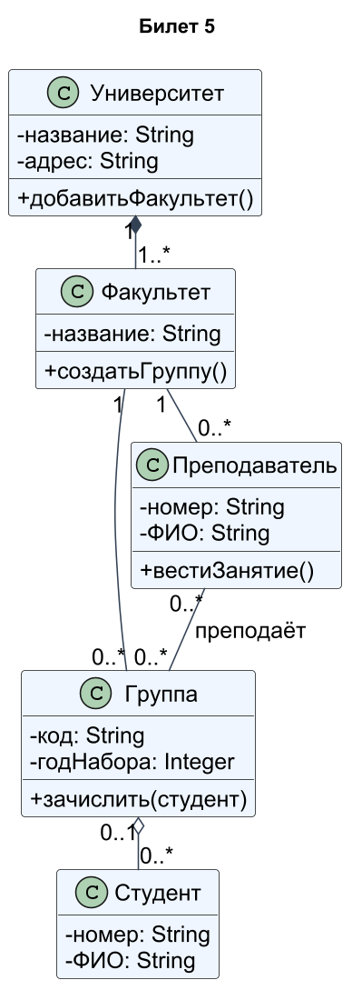
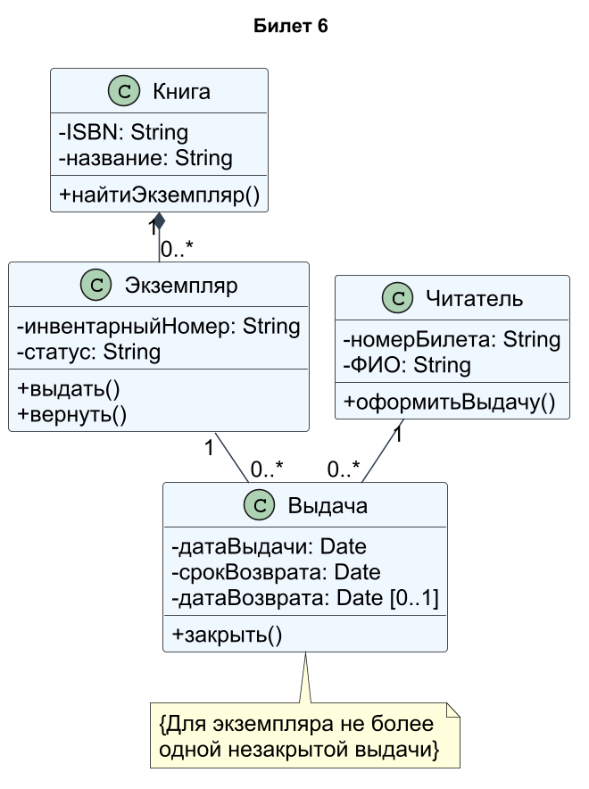
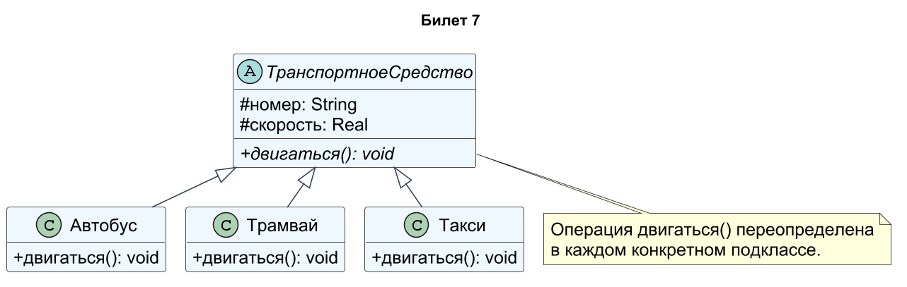
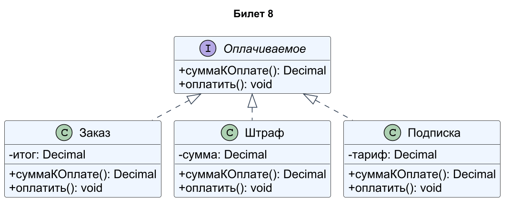

# Проектирование ПО · билеты 5–8

## Билет 5

### 1. Диаграмма вариантов использования: назначение, актёры, варианты использования, границы системы.

Диаграмма вариантов использования показывает внешние роли и цели их взаимодействия с системой. Актёр — роль человека, устройства или другой системы, а не обязательно отдельный человек. Вариант использования — значимый для актёра результат, обозначаемый эллипсом с глагольным названием. Прямоугольник границы системы отделяет её функции от внешних участников. Ассоциации показывают участие актёра; например, Читатель связан с «Бронировать книгу». Такая диаграмма описывает функциональные требования, но не порядок экранов и не внутренний алгоритм.

### 2. Методика SPMN: цели создания, подход Critical Best Practices и его основные направления.

SPMN (Software Program Managers Network) распространяла практики управления крупными программными проектами, направленные на снижение рисков, срывов сроков и перерасхода. Подход Critical Best Practices предлагает конкретные измеримые действия, применимые к разным жизненным циклам. Направления 16-Point Plan: управление проектом, построение продукта, стабильность и целостность продукта. В отличие от оценки уровня организации, акцент делается на том, что руководитель и команда должны делать в проекте: контролировать риски, требования, качество, стоимость и сроки. [Статья представителя U.S. Navy о 16 практиках](https://citeseerx.ist.psu.edu/document?doi=f32a9624fb091b318f7f796ac6ad23e68dd15ab9&repid=rep1&type=pdf).

### Практическое задание

Университет. Классы: Университет, Факультет, Группа, Студент, Преподаватель. Указать атрибуты и кратности. Факультеты входят в университет (композиция), студенты входят в группу (агрегация).

### Решение

Композиция Университет–Факультет соответствует условию: факультет принадлежит одному университету, университет содержит один или более факультетов. Группа относится к одному факультету, факультет имеет 0..* групп. Пустой ромб Группа–Студент означает агрегацию: удаление группы не уничтожает сведения о студентах. Принято, что студент находится максимум в одной текущей группе (0..1), преподаватель закреплён за одним факультетом и может преподавать нескольким группам. Эти допущения задают точные кратности, атрибуты и операции показаны в классах.

[Исходник диаграммы](схемы/05.puml)

---

## Билет 6

### 1. Отношения на диаграмме вариантов использования: ассоциация, обобщение, включение (include) и расширение (extend).

Ассоциация соединяет актёра с вариантом использования и означает участие. Обобщение показывает, что специализированный актёр или вариант наследует свойства общего; пустой треугольник направлен к общему элементу. **include** выделяет обязательное включаемое поведение: пунктирная стрелка направлена от основного варианта к включаемому. **extend** добавляет поведение при условии в точке расширения: стрелка идёт от расширяющего варианта к базовому. Например, «Снять деньги» include «Проверить ПИН», а «Напечатать чек» extend «Снять деньги» при выборе клиента. Эти отношения не обозначают простую временную очередность действий.

### 2. Критические практики SPMN: состав и содержание. Сравнение методики SPMN с моделью CMM.

В 16-пунктовом плане SPMN перечисляются: формальное управление рисками; эмпирическая оценка стоимости и сроков; управление метриками; отслеживание освоенного объёма; контроль дефектов относительно целей качества; приоритет людей; управление конфигурацией всего жизненного цикла; управление и трассировка требований; проектирование ПО в контексте системы; совместимость данных и БД; определение и контроль интерфейсов; проверка требований и проекта; «спроектируй дважды, кодируй один раз»; непрерывное тестирование; частые сборки и smoke-тесты; оценка рисков и стоимости повторного использования. Смысл — обнаруживать отклонения рано и опираться на факты. CMM описывает зрелость процессов организации, SPMN — набор практических мер управления проектом; подходы могут дополнять друг друга. [Перечень в Crosstalk](https://citeseerx.ist.psu.edu/document?doi=8c23e54e9501b7a31501a7a0d3b03065d34edbda&repid=rep1&type=pdf).

### Практическое задание

Библиотека. Классы: Книга, Экземпляр, Читатель, Выдача. Указать атрибуты, операции и кратности. Экземпляр не существует без книги.

### Решение

Книга описывает издание, Экземпляр — физическую единицу с инвентарным номером. По условию их связывает композиция с ромбом у Книги. Каждая Выдача относится ровно к одному читателю и экземпляру; у обоих может быть множество исторических выдач. Ограничение «не более одной незакрытой выдачи для экземпляра» не заменяется кратностью 0..1, иначе теряется история. Возврат закрывает выдачу и меняет статус экземпляра; книга и экземпляр имеют разные идентификаторы.

[Исходник диаграммы](схемы/06.puml)

---

## Билет 7

### 1. Описание вариантов использования: сценарии, основной и альтернативные потоки, пред- и постусловия.

Текст варианта использования содержит цель, актёров, предусловия, триггер, основной поток, альтернативы, исключения и постусловия. Основной поток описывает успешное достижение цели шагами «действие актёра — реакция системы». Альтернатива задаёт допустимое ответвление, исключение — обработку ошибки. Предусловие должно быть истинно до запуска, постусловие описывает состояние после завершения. Для записи к врачу предусловие — пациент идентифицирован, постусловие успеха — создана запись на свободное время; при занятом времени запись не создаётся. Шаги не должны без необходимости фиксировать детали интерфейса.

### 2. Применение практик SPMN в проекте: формальное управление рисками и управление на основе метрик (метод освоенного объёма).

Формальное управление рисками включает реестр: событие, вероятность, ущерб, владелец, профилактика, триггер и план реагирования. Риски ранжируют и регулярно пересматривают; риск — возможное событие, проблема — уже наступившее. Освоенный объём связывает выполненную работу с бюджетом: PV — плановая стоимость, EV — бюджетная стоимость реально выполненной работы, AC — фактические затраты. CV=EV−AC, SV=EV−PV, CPI=EV/AC, SPI=EV/PV. Например, PV=100, EV=80, AC=90: CPI≈0,89 и SPI=0,8, значит есть перерасход относительно выполненного объёма и отставание от плана. EV определяют по подтверждённым результатам, а не по субъективному «почти готово».

### Практическое задание

Транспорт. Абстрактный класс ТранспортноеСредство (номер, скорость, двигаться()). Наследники: Автобус, Трамвай, Такси. Показать обобщение и переопределение операции.

### Решение

ТранспортноеСредство абстрактно: непосредственно его экземпляр не создаётся. Общие защищённые атрибуты номер и скорость наследуют Автобус, Трамвай и Такси. Каждый конкретный класс переопределяет двигаться(): автобус следует дорожному маршруту, трамвай — рельсовому, такси — выбранному заказу. Пустые треугольники направлены к родительскому классу. Клиентский код может вызывать двигаться() через общий тип, получая полиморфное поведение.

[Исходник диаграммы](схемы/07.puml)

---

## Билет 8

### 1. Диаграмма классов: назначение, изображение класса, атрибуты и операции, видимость элементов.

Диаграмма классов показывает статическую структуру системы: классы, их свойства, операции и отношения. Класс изображают прямоугольником с секциями имени, атрибутов и операций. Атрибут: -баланс: Decimal; операция: +пополнить(сумма: Decimal): void. Видимость: + public, - private, # protected, ~ package. Абстрактные элементы выделяют курсивом или пометкой {abstract}, статические подчёркивают. Диаграмма задаёт типы и правила связей, но не конкретные значения отдельных объектов в момент времени.

### 2. Понятие модели и визуального моделирования. Цели моделирования программных систем.

Модель — целенаправленное упрощённое представление системы, сохраняющее важные для задачи свойства. Визуальное моделирование выражает эти свойства графически: через элементы, связи и правила нотации. Цели — понять предметную область, согласовать требования, сравнить архитектурные решения, обнаружить противоречия и документировать систему. Одна диаграмма не раскрывает все аспекты, поэтому используют взаимосвязанные виды. Например, диаграмма классов показывает структуру заказа, а последовательности — взаимодействие при оплате. Полезность модели определяется её точностью для поставленной цели, а не количеством деталей.

### Практическое задание

Оплата. Интерфейс Оплачиваемое (суммаКОплате(), оплатить()) реализуют классы Заказ, Штраф, Подписка.

### Решение

Оплачиваемое объявляет две публичные операции: суммаКОплате(): Decimal и оплатить(): void. Заказ, Штраф и Подписка реализуют этот контракт, что показано пунктирными стрелками с пустым треугольником к интерфейсу. Сумма заказа вычисляется по позициям, штрафа — по начислению, подписки — по тарифу. Общий обработчик работает с интерфейсом и не обязан знать конкретный класс. Денежные значения моделируются десятичным типом, чтобы не вводить ошибки двоичной арифметики.

[Исходник диаграммы](схемы/08.puml)
