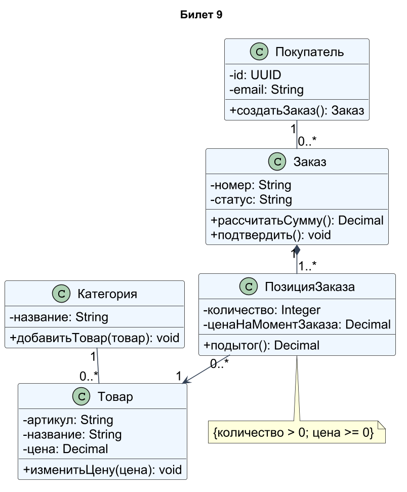
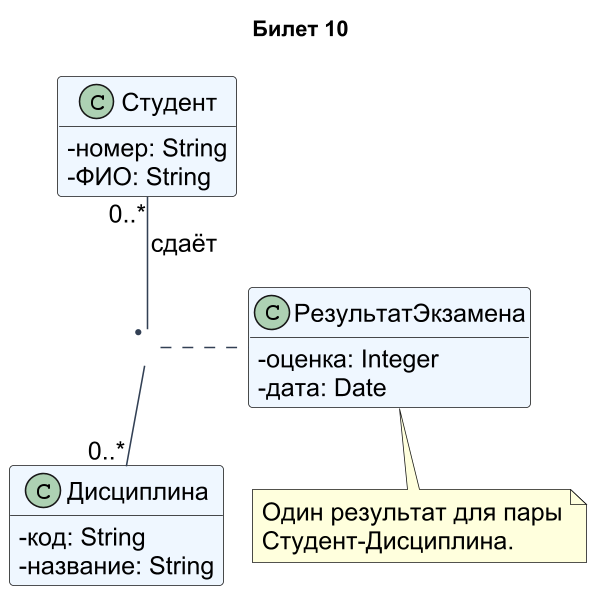
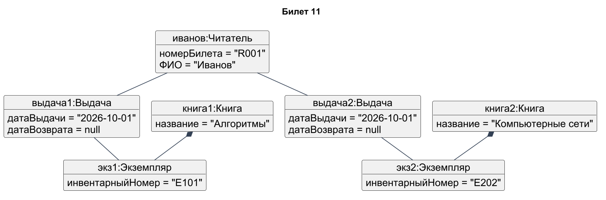
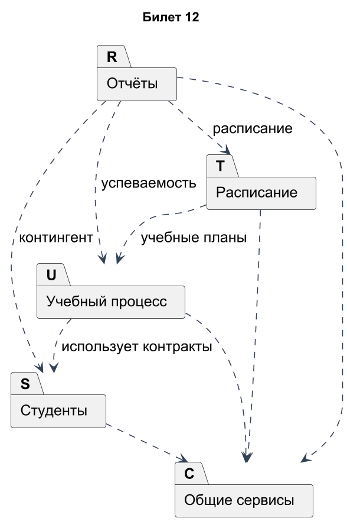

# Проектирование ПО · билеты 9–12

## Билет 9

### 1. Отношения на диаграмме классов: ассоциация (кратность, роли, навигация), агрегация, композиция, обобщение, зависимость, реализация.

Ассоциация — устойчивая структурная связь; у концов задают роли, навигацию и кратности, например Покупатель 1 — 0..* Заказ. Агрегация с пустым ромбом у целого означает слабое отношение «целое–часть» без жёсткого владения жизненным циклом. Композиция с заполненным ромбом означает исключительное владение частью в модели; часть не принадлежит двум композиционным целым одновременно. Обобщение — отношение «является разновидностью» с пустым треугольником к родителю. Зависимость — использование элемента, реализация — выполнение контракта интерфейса; обе обычно пунктирные, но реализация имеет пустой треугольник. Кратность у конца показывает число экземпляров этого конца для одного экземпляра противоположного.

### 2. Основные принципы моделирования. Классификация моделей по аспекту, уровню абстракции и назначению.

Принципы моделирования: выбирать существенные свойства под цель, поддерживать связь с реальностью, применять несколько согласованных представлений и уточнять модель постепенно. По аспекту модели бывают структурные, поведенческие и функциональные; по уровню — концептуальные, логические и физические; по назначению — описательные, аналитические, проектные и исполняемые. Концептуальная модель говорит о понятиях предметной области, физическая — о технологии и размещении. Не следует смешивать уровни без пояснения: «Заказ» как бизнес-понятие не равен таблице БД или REST-контроллеру. Проверяют полноту по требованиям и непротиворечивость связей.

### Практическое задание

Интернет-магазин. Классы: Покупатель, Заказ, ПозицияЗаказа, Товар, Категория. Указать видимость, операции и все кратности.

### Решение

Покупатель может иметь 0..* заказов, каждый заказ принадлежит одному покупателю. Подтверждаемый заказ содержит 1..* позиций и владеет ими через композицию. Каждая позиция ссылается на один товар, товар участвует в 0..* позициях разных заказов. Принято, что товар относится ровно к одной категории; категория содержит 0..* товаров. Цена фиксируется в позиции на момент заказа, поэтому изменение каталога не меняет прошлые суммы. Поля закрыты (-), операции публичны (+), количество должно быть положительным.

[Исходник диаграммы](схемы/09.puml)

---

## Билет 10

### 1. Абстрактные классы, интерфейсы, классы-ассоциации и шаблоны (параметризованные классы) на диаграмме классов.

Абстрактный класс задаёт общие свойства и может содержать реализованные операции, но непосредственно не создаётся; абстрактная операция требует реализации в конкретном потомке. Интерфейс задаёт контракт, который реализуют независимые классы. Класс-ассоциация хранит свойства самой связи: у отношения Студент–Дисциплина это оценка и дата экзамена. Он соединяется пунктиром с линией ассоциации. Шаблон задаёт параметризованный элемент, например Коллекция<T>; параметры обозначают в пунктирной рамке. Это разные способы повторного использования, а не взаимозаменяемые символы.

### 2. Структурный и объектно-ориентированный подходы к моделированию. Понятия нотации, метода и методологии.

Структурный подход раскладывает систему на функции и потоки данных, например DFD и иерархию модулей. Объектный подход объединяет состояние и поведение в объекты, распределяя обязанности между ними. Нотация — система графических и текстовых обозначений; метод — способ решения задачи; методология — совокупность принципов, методов и правил организации работ. UML является языком/нотацией моделирования, а не полной методологией разработки. Подходы можно сочетать: функциональная модель помогает понять процесс, объектная — спроектировать участников его реализации.

### Практическое задание

Экзамены. Студент сдаёт много дисциплин, по дисциплине сдают много студентов, для каждой пары известны оценка и дата. Показать класс-ассоциацию «РезультатЭкзамена».

### Решение

Ассоциация Студент–Дисциплина имеет кратности 0..* с обеих сторон. Класс-ассоциация РезультатЭкзамена присоединён пунктиром к самой связи и хранит её оценку и дату. Допущение задания: один результат на пару студент–дисциплина. Если необходимо хранить несколько пересдач, следует ввести отдельную сущность ПопыткаЭкзамена с номером попытки; простая уникальная связь пары этого не выражает. В представленной модели дата и оценка не принадлежат отдельно студенту или дисциплине.

[Исходник диаграммы](схемы/10.puml)

---

## Билет 11

### 1. Диаграмма объектов: назначение, изображение объектов и связей, отличие от диаграммы классов.

Диаграмма объектов показывает конкретный снимок экземпляров и связей. Заголовок экземпляра подчёркивают и записывают как имя:Класс, например читатель1:Читатель; ниже указывают значения слотов: фамилия="Иванов". Линия между объектами — экземпляр ассоциации, то есть link. Диаграмма классов задаёт допустимые типы и кратности, диаграмма объектов показывает один допустимый набор экземпляров. Её используют для примеров, тестовых данных и проверки понимания модели. Если на снимке один экземпляр принадлежит двум композиционным владельцам, это противоречит модели.

### 2. Критерии качества визуальной модели. CASE-средства: назначение и возможности.

Качественная модель корректна по нотации, понятна аудитории, достаточна для цели, согласована с требованиями и другими диаграммами. Проверяют имена, кратности, направления отношений, достижимость состояний, полноту сценариев и отсутствие лишних деталей. CASE-средства поддерживают построение диаграмм, единый репозиторий, трассировку, проверку модели, генерацию документации и иногда кода или обратное проектирование. Автоматическая генерация не гарантирует правильность требований. Например, средство может проверить синтаксис стрелки, но смысл «студент владеет университетом» должен оценить аналитик.

### Практическое задание

Диаграмма объектов для системы «Библиотека» (классы Книга, Экземпляр, Читатель, Выдача): читатель Иванов взял два экземпляра разных книг.

### Решение

Показан конкретный снимок: иванов:Читатель связан с двумя объектами Выдача. Первая выдача ссылается на экз1 книги «Алгоритмы», вторая — на экз2 книги «Компьютерные сети». У обеих выдач датаВозврата=null, то есть они активны. Объекты названы в форме имя:Класс и содержат значения атрибутов. Это пример экземпляров модели билета 6, а не ещё одна диаграмма типов; две разные книги и два экземпляра представлены отдельно.

[Исходник диаграммы](схемы/11.puml)

---

## Билет 12

### 1. Диаграмма пакетов: назначение, пакеты, отношения между пакетами (импорт, доступ, зависимость).

Пакет — пространство имён и средство группировки элементов; изображается прямоугольником с вкладкой. Зависимость A→B означает, что элементы A используют B и изменение B может затронуть A. «import» делает импортированные имена доступными в импортирующем пространстве с публичной видимостью, «access» задаёт приватный импорт без дальнейшего публичного экспорта. Полное имя может быть УчебныйПроцесс::Дисциплина. Пакеты помогают разделять ответственность и управлять зависимостями. Следует избегать циклов, когда несколько крупных пакетов не могут изменяться независимо.

### 2. Сущность структурного подхода. Базовые и дополнительные принципы структурного анализа.

Структурный подход рассматривает систему как иерархию преобразований входных данных в выходные. Базовые принципы — декомпозиция и иерархическая организация: сложную функцию разбивают на меньшие и уточняют сверху вниз. Дополнительно применяют абстрагирование, формализацию, согласованность, полноту, разделение логического и физического описаний. На каждом уровне сохраняют связь с внешними входами и выходами. Для процесса «Обработать заказ» выделяют «Проверить данные», «Резервировать товар», «Принять оплату», «Организовать доставку».

### Практическое задание

Диаграмма пакетов системы колледжа: Студенты, Учебный процесс, Расписание, Отчёты, Общие сервисы, с зависимостями.

### Решение

Пакет «Учебный процесс» использует сведения о студентах, «Расписание» — учебные планы, а «Отчёты» — данные всех трёх предметных пакетов. «Общие сервисы» предоставляет общие технические возможности: авторизацию, журналирование и уведомления. Стрелка зависимости направлена от использующего пакета к используемому. Обратные зависимости от общих сервисов к предметным пакетам не вводятся, поэтому архитектура не содержит циклов. Это зависимости контрактов, а не последовательность запуска модулей.

[Исходник диаграммы](схемы/12.puml)
